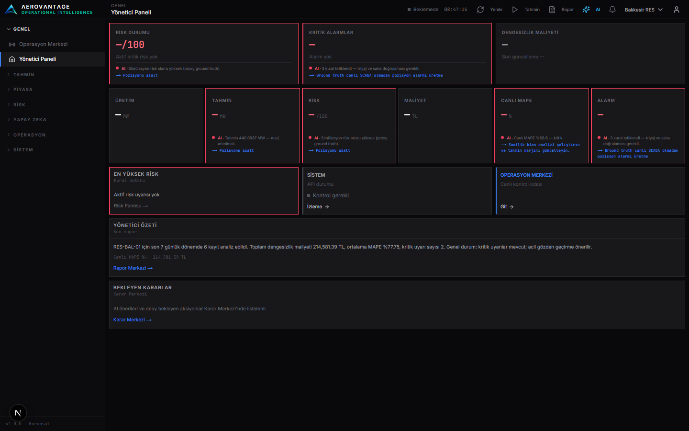

# AeroVantage

**Entscheidungsplattform für den Energieanlagenbetrieb — v1.0.0-rc1**  
**Wartungsmodus:** v1.x-Entwicklungszyklus geschlossen. Neue Ideen → `docs/V2-BACKLOG.md`. Primärer Fokus → `docs/HYPER-CORE.md`.

Vollständige englische README: **[README.md](README.md)**  
(Features, Architektur, Setup, Env, Screenshots, Limitations, FAQ, Security.)

Kurzfassung:

- Next.js UI + FastAPI + BFF  
- EPİAŞ + Wetter live · SCADA simuliert · Gemini (Playbook-Fallback)  
- Sprachen: TR / EN / DE  
- Demo: [docs/DEMO-RUNBOOK.md](docs/DEMO-RUNBOOK.md)  
- Lizenz: [LICENSE](LICENSE) · Security: [SECURITY.md](SECURITY.md)

  

