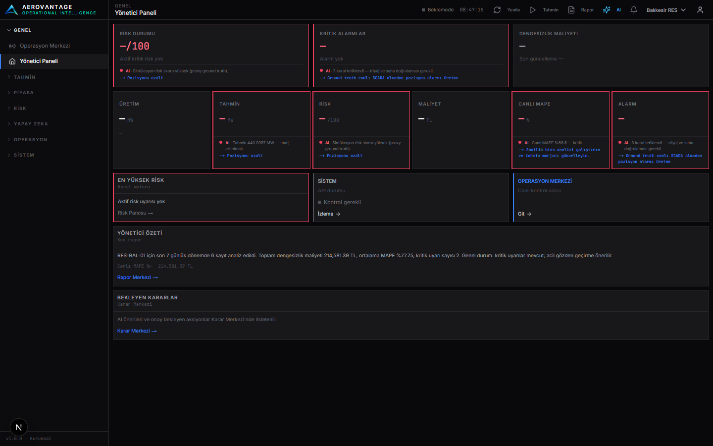
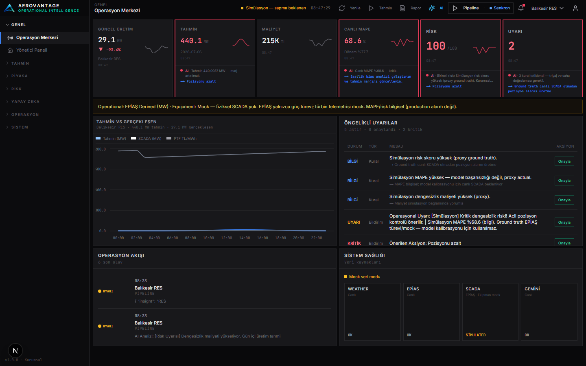
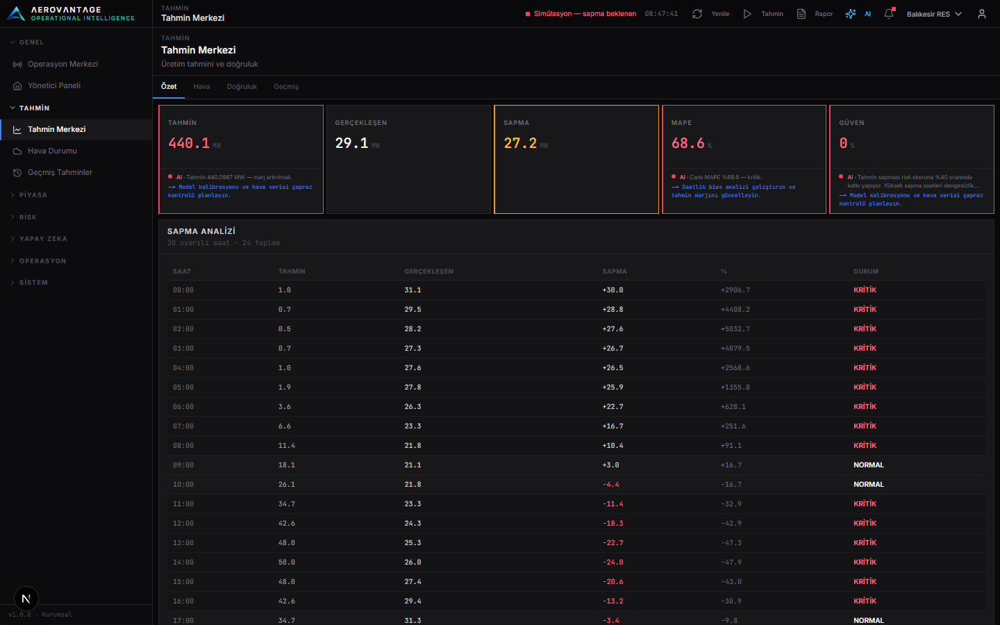
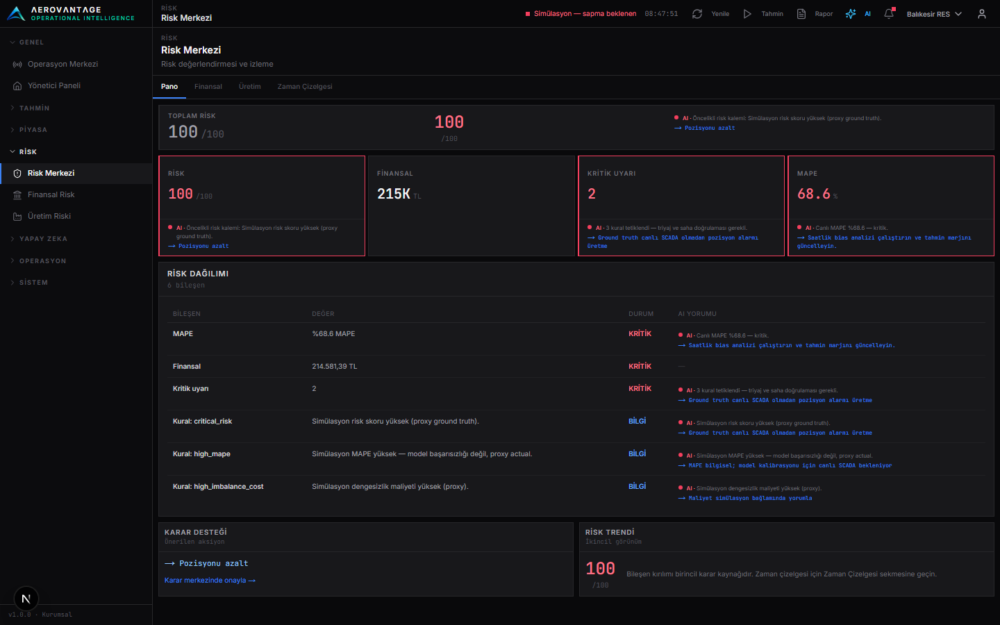
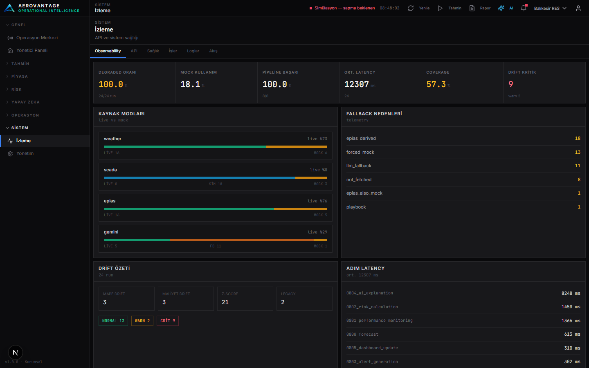
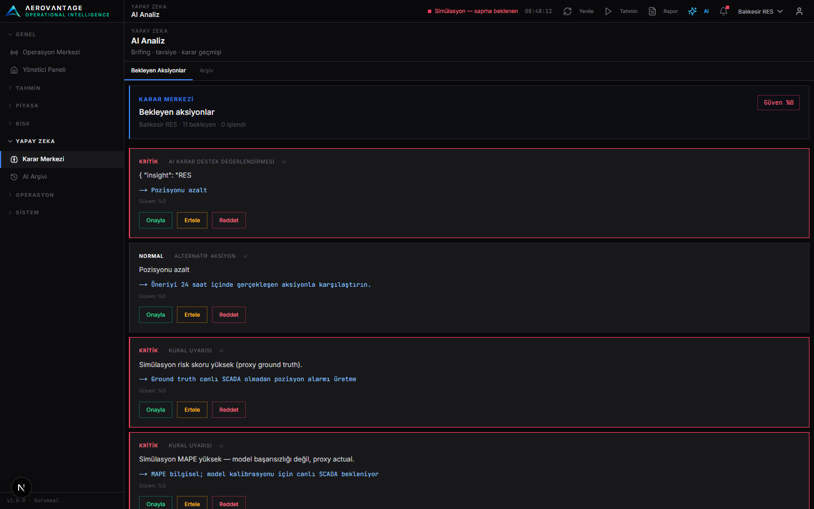
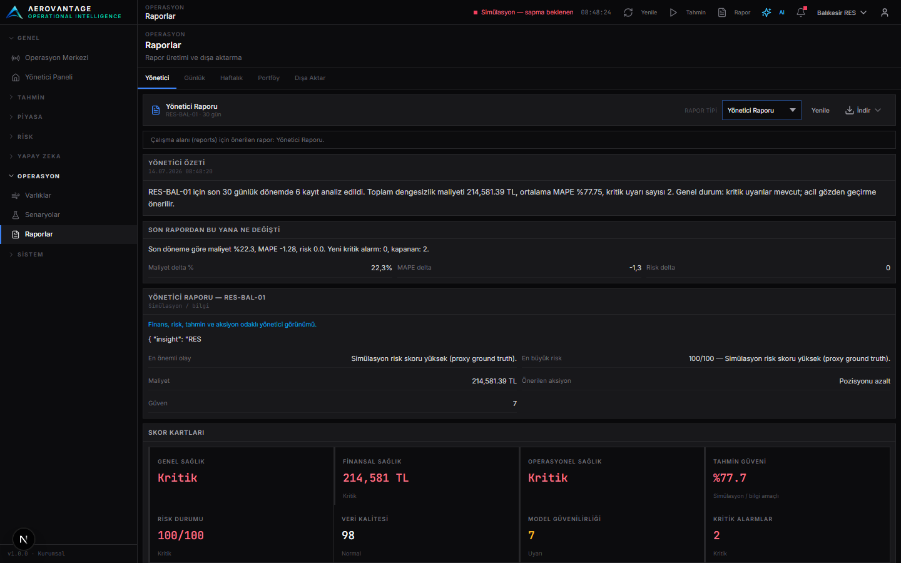
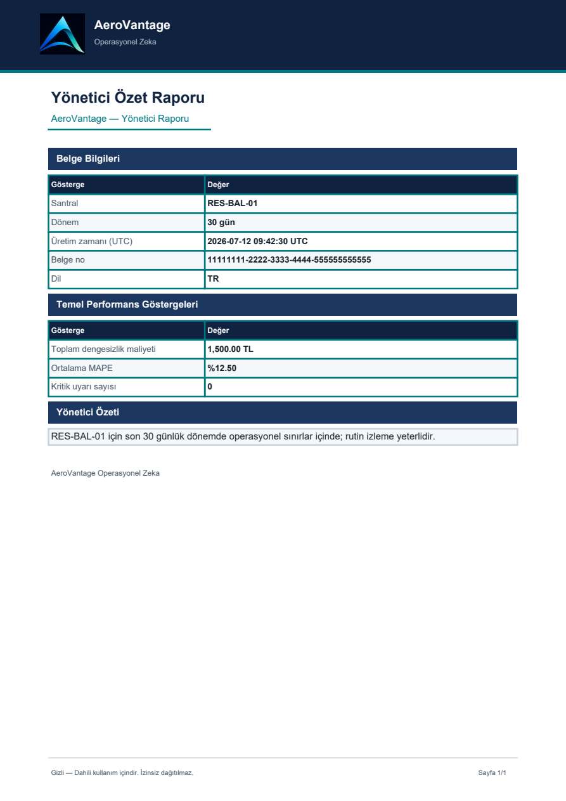
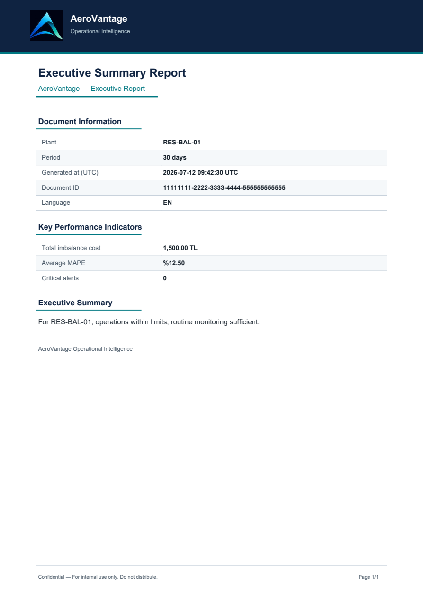

# AeroVantage

[](LICENSE)
[](CHANGELOG.md)
[](https://www.python.org/)
[](https://nextjs.org/)

<p align="center">
  
</p>

<h3 align="center">Energy Operations Decision Support Platform</h3>
<p align="center">
  See financial risk and AI operational insight in seconds.<br/>
  Unify forecast, market prices, imbalance cost, and decisions in one Operational Intelligence pipeline.
</p>

<p align="center">
  <a href="#quick-start"><strong>Quick Start</strong></a> ·
  <a href="#screenshots"><strong>Screenshots</strong></a> ·
  <a href="docs/DEMO-RUNBOOK.md"><strong>Demo Runbook</strong></a> ·
  <a href="docs/architecture.md"><strong>Architecture</strong></a>
</p>

---

## Project Overview

AeroVantage is a modular decision-support system for wind plant operators. It runs a daily event pipeline (forecast → performance → risk → alerts → AI) and presents results in a dark ops console built with **Next.js**, backed by **FastAPI**.

The browser never holds API secrets: the Next.js **BFF** (`/api/backend`, `/api/export/*`) injects server-side auth toward FastAPI.

| | |
|--|--|
| **Version** | **v1.0.0-rc1** (Release Candidate 1) |
| **Mode** | **Maintenance Mode** — Feature Complete; no new v1.x product scope |
| **Languages** | Turkish (default), English, German |
| **Data posture** | EPİAŞ + Weather **live** · SCADA **simulated** · LLM **Gemini** (playbook fallback) |
| **Primary focus (next)** | **Hyper Core** — see [`docs/HYPER-CORE.md`](docs/HYPER-CORE.md) |

---

## Features

- **Executive Dashboard** — risk, cost, alerts, and executive summary at a glance  
- **Operations Center** — live control-room style KPI and feeds  
- **Forecast** — production / weather views with locale-aware charts  
- **Risk** — financial and production deviation analysis  
- **Monitoring** — health, degraded mode, observability summaries  
- **AI Assistant** — context briefing + decision support (Gemini / playbook)  
- **Reports** — executive / typed packs, PDF·Excel·CSV export, report Q&A  
- **i18n** — TR / EN / DE across UI, AI, and exports  
- **Quality gates** — pytest reliability suites + frontend lint / tsc / build  

---

## Technology Stack

| Layer | Technology |
|-------|------------|
| UI | Next.js (App Router), TypeScript (`strict`), Tailwind |
| BFF | Next.js Route Handlers (server-only `API_SECRET_KEY`) |
| API | FastAPI, Python 3.11+ |
| Domain | `modules/*` + `core/pipeline.py` |
| AI | Google Gemini · playbook fallback |
| Data | EPİAŞ, Open-Meteo, SCADA adapter (simulated provider) |
| Packaging | Docker Compose · optional Windows tray / Inno |
| CI | GitHub Actions `quality-gates.yml` |

---

## Architecture

```
┌─────────────────────────────────────────┐
│  frontend/  Next.js UI + BFF            │
└──────────────────┬──────────────────────┘
                   │ HTTP + Bearer (server)
┌──────────────────▼──────────────────────┐
│  api/  FastAPI (routing only)           │
└──────────────────┬──────────────────────┘
                   │
┌──────────────────▼──────────────────────┐
│  modules/*  forecast · market · risk ·  │
│             reporting · ai · …          │
└──────────────────┬──────────────────────┘
                   │
┌──────────────────▼──────────────────────┐
│  core/  pipeline · i18n · DQ · storage  │
└─────────────────────────────────────────┘
```

Full diagram and dependency rules: **[docs/architecture.md](docs/architecture.md)**

### Daily pipeline

```
Forecast → Performance → Risk → Alerts → AI → Dashboard / Reports
```

```http
POST /api/v1/pipeline/trigger-pipeline
{ "asset_id": "RES-BAL-01", "target_date": "2026-07-14" }
```

---

## Screenshots

> Captured from the Next.js UI (dark ops console). Report samples included.

### Executive Dashboard



### Operations



### Forecast



### Risk



### Monitoring



### AI Assistant



### Reports



| Export sample (TR) | Export sample (EN) |
|--------------------|--------------------|
|  |  |

---

## Installation

### Prerequisites

- Python 3.11+
- Node.js 20+
- npm
- (Optional) Docker Desktop

### Local setup

```powershell
git clone <your-fork-or-repo-url>
cd aerovantage
copy .env.example .env
copy frontend\.env.local.example frontend\.env.local
# Edit .env with EPİAŞ / LLM credentials as needed
install.bat
```

Or manually:

```powershell
pip install -r requirements.txt
cd frontend
npm ci
```

---

## Quick Start

```powershell
# Terminal 1 — API
uvicorn api.main:app --reload --host 127.0.0.1 --port 8000

# Terminal 2 — UI
cd frontend
npm run dev
```

Open **http://localhost:3000** · API docs **http://127.0.0.1:8000/docs**

Pre-demo check:

```powershell
python scripts/smoke_demo.py
```

### Docker

```powershell
docker compose up --build
```

Legacy Streamlit (optional): `docker compose --profile legacy up`

---

## Environment Variables

### Root `.env` (from `.env.example`)

| Variable | Purpose | Notes |
|----------|---------|--------|
| `EPIAS_USERNAME` / `EPIAS_PASSWORD` | EPİAŞ CAS | Required for live market/generation |
| `EPIAS_USE_MOCK` | Force mock EPİAŞ | Demo RC: `false` |
| `WEATHER_USE_MOCK` | Force mock weather | Demo RC: `false` |
| `SCADA_USE_MOCK` | Simulated SCADA | Demo RC: `true` |
| `SCADA_API_URL` | Live SCADA REST | Empty while simulated |
| `LLM_PROVIDER` | `mock` / `gemini` / `openai` | Demo RC: `gemini` |
| `LLM_API_KEY` | LLM credential | Never commit |
| `API_SECRET_KEY` | FastAPI Bearer | Match frontend BFF |

### `frontend/.env.local` (from `.env.local.example`)

| Variable | Purpose |
|----------|---------|
| `API_BACKEND_URL` | FastAPI origin (e.g. `http://127.0.0.1:8000`) |
| `API_SECRET_KEY` | Same value as root — **server-only**, never `NEXT_PUBLIC_*` |

See also [SECURITY.md](SECURITY.md).

---

## Known Limitations

- **SCADA is simulated** (EPİAŞ-derived) — not live plant telemetry; adapter is swap-ready.  
- **National wind → plant scale** approximation — not site-specific SCADA actuals.  
- **Auth** is a shared API Bearer (pilot) — not corporate IdP / RBAC.  
- Example / Docker **default API keys** must be overridden for shared deployments.  
- **Hybrid XGB** may fall back to physics if artifacts are missing.  
- **LLM** uses Gemini with automatic playbook fallback.  
- **Streamlit** UI is legacy-only; primary surface is Next.js.  
- **CORS** is localhost-oriented for demo.

---

## Roadmap & project status

**AeroVantage v1.x development cycle is closed** (FAZ 1–7 complete). The product is in **Maintenance Mode**.

| Doc | Role |
|-----|------|
| [`docs/AEROVANTAGE-FINAL-ROADMAP.md`](docs/AEROVANTAGE-FINAL-ROADMAP.md) | Locked historical plan (complete) |
| [`docs/V1-MAINTENANCE-POLICY.md`](docs/V1-MAINTENANCE-POLICY.md) | What may still change on v1.x |
| [`docs/V2-BACKLOG.md`](docs/V2-BACKLOG.md) | New AeroVantage ideas only — **do not implement on v1.x** |
| [`docs/HYPER-CORE.md`](docs/HYPER-CORE.md) | Primary future development focus pointer |
| [`docs/RELEASE-NOTES-v1.0.0-rc1.md`](docs/RELEASE-NOTES-v1.0.0-rc1.md) | RC1 release notes |

Release hygiene: [`docs/RELEASE-CHECKLIST.md`](docs/RELEASE-CHECKLIST.md) · Demo: [`docs/DEMO-RUNBOOK.md`](docs/DEMO-RUNBOOK.md)

---

## FAQ

**Does AeroVantage require live SCADA?**  
No for RC1 — SCADA is simulated. Provide a REST SCADA provider later without rewriting the OI layer.

**Where do API secrets live?**  
Root `.env` and server-only `frontend/.env.local`. Never in the browser.

**How do I change language?**  
Administration → Language (TR / EN / DE), no full reload.

**Is Streamlit still supported?**  
Legacy profile only. Product UI is Next.js.

**How do I verify before a demo?**  
`python scripts/smoke_demo.py` and follow `docs/DEMO-RUNBOOK.md`.

---

## Changelog

See **[CHANGELOG.md](CHANGELOG.md)** — current: `1.0.0-rc1`.

---

## License

MIT — **[LICENSE](LICENSE)**. Pilot / internship demonstration scope; keep credentials out of git.

---

## Security

Report vulnerabilities and secret handling rules: **[SECURITY.md](SECURITY.md)**.

---

## Contributing

Quality gates and freeze rules: **[CONTRIBUTING.md](CONTRIBUTING.md)**.

---

## Documentation Index

| Doc | Link |
|-----|------|
| Architecture | [docs/architecture.md](docs/architecture.md) |
| Demo runbook | [docs/DEMO-RUNBOOK.md](docs/DEMO-RUNBOOK.md) |
| Deployment | [docs/DEPLOYMENT.md](docs/DEPLOYMENT.md) |
| User guide | [docs/USER-GUIDE.en.md](docs/USER-GUIDE.en.md) |
| v1.x maintenance policy | [docs/V1-MAINTENANCE-POLICY.md](docs/V1-MAINTENANCE-POLICY.md) |
| Hyper Core (primary focus) | [docs/HYPER-CORE.md](docs/HYPER-CORE.md) |
| v2 backlog (ideas only) | [docs/V2-BACKLOG.md](docs/V2-BACKLOG.md) |
| RC1 release notes | [docs/RELEASE-NOTES-v1.0.0-rc1.md](docs/RELEASE-NOTES-v1.0.0-rc1.md) |
| RC verification | [docs/RC-VERIFICATION.md](docs/RC-VERIFICATION.md) |
| Live data cutover | [docs/LIVE-DATA-CUTOVER.md](docs/LIVE-DATA-CUTOVER.md) |
| SCADA adapter | [docs/SCADA-ADAPTER.md](docs/SCADA-ADAPTER.md) |
| AI / ML ops | [docs/AI-ML-OPS.md](docs/AI-ML-OPS.md) |
| G1 test report | [docs/SPRINT-G1-FINAL-TEST-REPORT.md](docs/SPRINT-G1-FINAL-TEST-REPORT.md) |

Other languages: [README.tr.md](README.tr.md) · [README.de.md](README.de.md)
