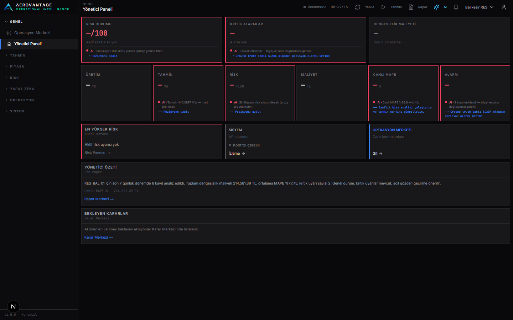

# AeroVantage

**Enerji Operasyonları Karar Destek Platformu — v1.0.0-rc1**  
**Bakım Modu:** v1.x geliştirme döngüsü kapandı. Yeni fikirler → `docs/V2-BACKLOG.md`. Birincil odak → `docs/HYPER-CORE.md`.

Tam İngilizce vitrin README: **[README.md](README.md)**  
(Özellikler, mimari, kurulum, env, ekran görüntüleri, kısıtlar, FAQ, güvenlik.)

Kısa Türkçe özet:

- Next.js UI + FastAPI + BFF  
- EPİAŞ + Weather canlı · SCADA simüle · Gemini (playbook yedek)  
- Dil: TR / EN / DE  
- Demo: [docs/DEMO-RUNBOOK.md](docs/DEMO-RUNBOOK.md)  
- Lisans: [LICENSE](LICENSE) · Güvenlik: [SECURITY.md](SECURITY.md)

  

